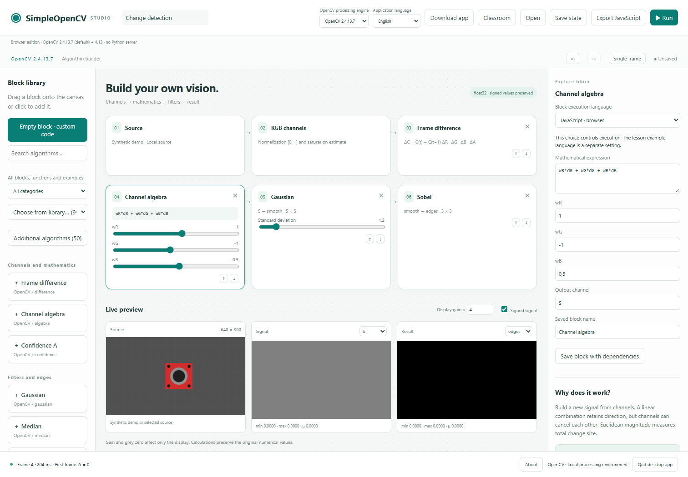

# SimpleOpenCV

### Build an algorithm. Change the mathematics. Save what works.

[](https://github.com/dromation/Simple-OpenCV/actions/workflows/tests.yml)
[](LICENSE)
[](docs/OPENCV24_WASM.md)

An open-source visual laboratory for computer vision. Separate RGB channels,
write equations, connect processing blocks and inspect the results. Save your
best configuration and export the algorithm for reuse.

**Genuine OpenCV 2.4.13.7 is the default engine.** OpenCV 4.13.0 is also bundled
for explicit comparisons. New workspaces start in English; select another
language in the header. Existing saved language and engine choices are preserved.



[Download](#download-and-run) · [Host on your domain](#put-it-on-your-domain) ·
[Classroom](docs/DETECTION_SEQUENCES.md) · [Contribute](CONTRIBUTING.md) ·
[Code of conduct](CODE_OF_CONDUCT.md) · [Licenses](THIRD_PARTY_NOTICES.md) · [Legacy](legacy/README.md)

## Download and run

Choose your platform from the **Download app** button on the application page,
or download a ZIP below. Extract it, then open the executable. The launcher
opens the complete application in your default browser. **No Python, Node.js or
Go installation is needed.** Both OpenCV engines, lessons and licenses are bundled.

| Platform | Download | Open after extraction |
| --- | --- | --- |
| Windows 10/11 · Intel/AMD x64 | [Windows ZIP](https://github.com/dromation/Simple-OpenCV/releases/download/v0.6.0/SimpleOpenCV-0.6.0-windows-amd64.zip) | `SimpleOpenCV.exe` |
| Linux · Intel/AMD x64 | [Linux x64 ZIP](https://github.com/dromation/Simple-OpenCV/releases/download/v0.6.0/SimpleOpenCV-0.6.0-linux-amd64.zip) | `./SimpleOpenCV` |
| Linux · ARM64 | [Linux ARM64 ZIP](https://github.com/dromation/Simple-OpenCV/releases/download/v0.6.0/SimpleOpenCV-0.6.0-linux-arm64.zip) | `./SimpleOpenCV` |
| macOS 13+ · Intel | [macOS Intel ZIP](https://github.com/dromation/Simple-OpenCV/releases/download/v0.6.0/SimpleOpenCV-0.6.0-macos-amd64.zip) | `SimpleOpenCV.app` |
| macOS 13+ · Apple Silicon | [macOS Apple Silicon ZIP](https://github.com/dromation/Simple-OpenCV/releases/download/v0.6.0/SimpleOpenCV-0.6.0-macos-arm64.zip) | `SimpleOpenCV.app` |

Use a current browser with WebAssembly. Keep the launcher running; **Quit desktop
app** in the footer stops it. Linux extractors must preserve executable permissions
(`chmod +x SimpleOpenCV` if necessary). Community builds are unsigned and macOS
bundles are not notarized. [Startup details and build instructions](docs/PORTABLE.md).

## Put it on your domain

Download [SimpleOpenCV-Website.zip](https://github.com/dromation/Simple-OpenCV/releases/download/v0.6.0/SimpleOpenCV-Website.zip),
upload it with cPanel File Manager and extract **all files** into the domain's
document root. `index.html` is at the ZIP root. This package includes the five
desktop downloads behind the page's download button.

Hosting only serves files: processing runs in the user's browser. No Python app,
Flask, Django, Passenger or API server is required. Use HTTPS for hosted camera
access. The smaller HTML ZIP uses GitHub release links for downloads instead.
[Upload instructions](deploy/static/UPLOAD-HTML.md).

## Experiment with the whole sequence

```text
Image / camera → RGB + confidence → frame differences → channel algebra
             → filters → edges / thresholds → components / lines

S = wR·ΔR + wG·ΔG + wB·ΔB
```

| Build | Explore | Keep |
| --- | --- | --- |
| 28 block types and a searchable library | RGB, signed differences and synthetic channels | JSON configurations with engine version |
| Editable formulas, kernels and parameters | Gaussian, median, Sobel, Scharr, morphology, Canny and Hough | Reusable blocks and example sequences |
| Empty blocks for custom code | Image, video, demo and explicitly permitted camera input | Runnable JavaScript export in portable/HTML editions |
| Classroom inside the app | Mathematics, detection recipes and programming examples | Local projects and downloadable backups |

The browser edition executes custom **JavaScript**. Python/C/C++/Java code can be
kept as disabled drafts; compiling those languages requires the developer/server
edition and its configured runtimes. The 2.4 browser build exposes core/imgproc
operations for the current blocks, not every OpenCV module. The derived A channel
is an experimental confidence weight, not an additional physical camera sensor.

Projects live in your browser's local storage. Website and desktop origins have
separate storage; transfer JSON and reselect media when moving between them.
No camera opens automatically. The default scene is synthetic.

## Why this exists

The idea grew from the author's SimpleCV experiments with separate RGB channels
and per-channel subtraction. SimpleOpenCV turns that experimental approach into
a workspace where changing an equation, parameter or processing order is visible
immediately. The project builds on Dromation's Simple-OpenCV repository and was
previously called SimpleMotocam. Read the fuller story in **About** inside the app.

The original repository is preserved under [legacy](legacy/README.md) and on the
`legacy` branch. The internal Python package remains `simplemotocam` for compatibility.
SimpleCV is an inspiration, not a bundled dependency or an official affiliation.

## Develop from source

```sh
git clone https://github.com/dromation/Simple-OpenCV.git
cd Simple-OpenCV
python -m venv .venv
# Windows: .venv\Scripts\activate
# Linux/macOS: source .venv/bin/activate
python -m pip install -e ".[dev]"
python tools/package_static.py
python -m http.server 8780 --bind 127.0.0.1 --directory dist
```

Open `http://127.0.0.1:8780/SimpleOpenCV-HTML/`. For native Python and compiled
custom-language blocks, prepare the genuine 2.4 native worker using the
[backend guide](docs/OPENCV_BACKENDS.md), then run `python -m simplemotocam.studio`.
For executable downloads, use [the portable build guide](docs/PORTABLE.md).

## Contributing and licensing

See [CONTRIBUTING.md](CONTRIBUTING.md), [contrib](contrib/README.md) and the
[code of conduct](CODE_OF_CONDUCT.md). Small reproducible experiments, clearer
mathematics, language reviews and useful block sequences are welcome.

Project-authored code is MIT, retaining the original Dromation attribution.
OpenCV 2.4 uses its BSD notice; OpenCV 4.13 uses Apache-2.0. Dependencies retain
their own licenses. Original license texts, provenance and version boundaries
are available offline in **About** and [THIRD_PARTY_NOTICES.md](THIRD_PARTY_NOTICES.md).
