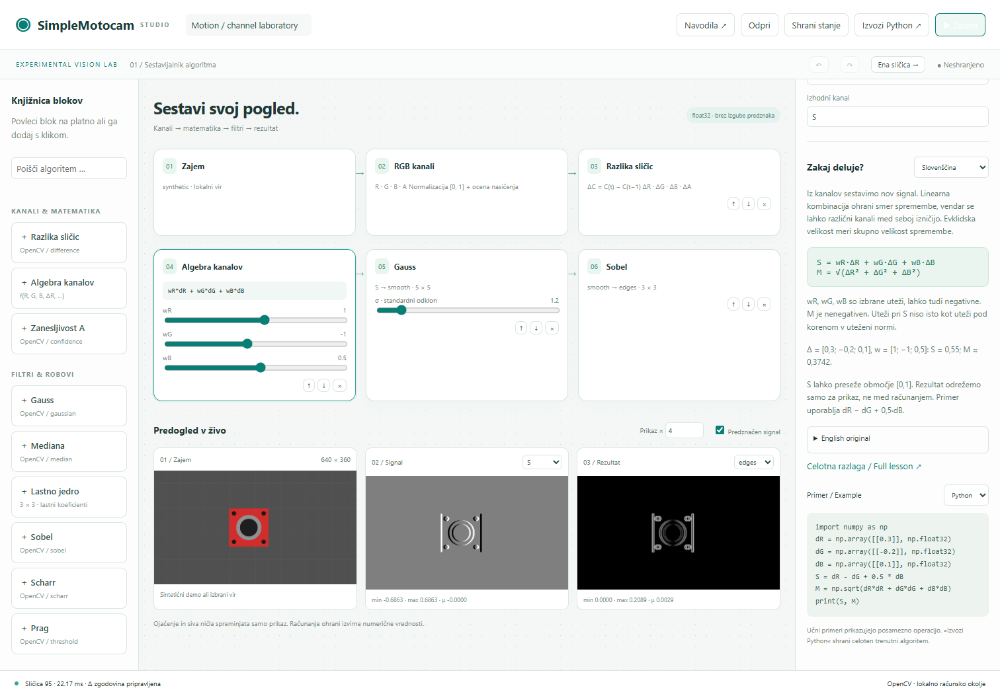
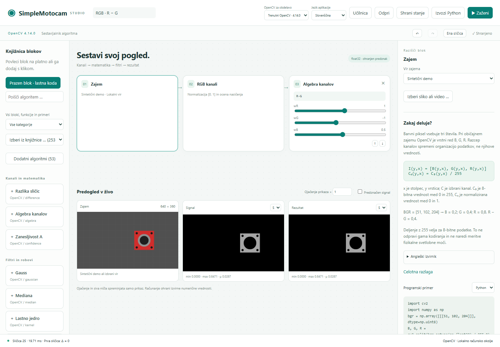
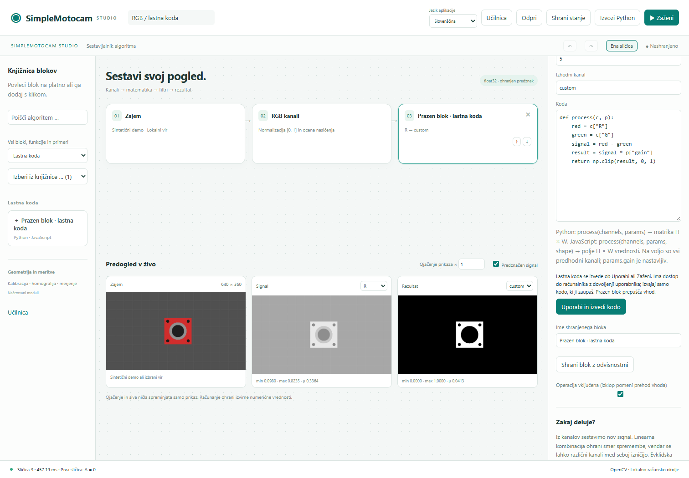
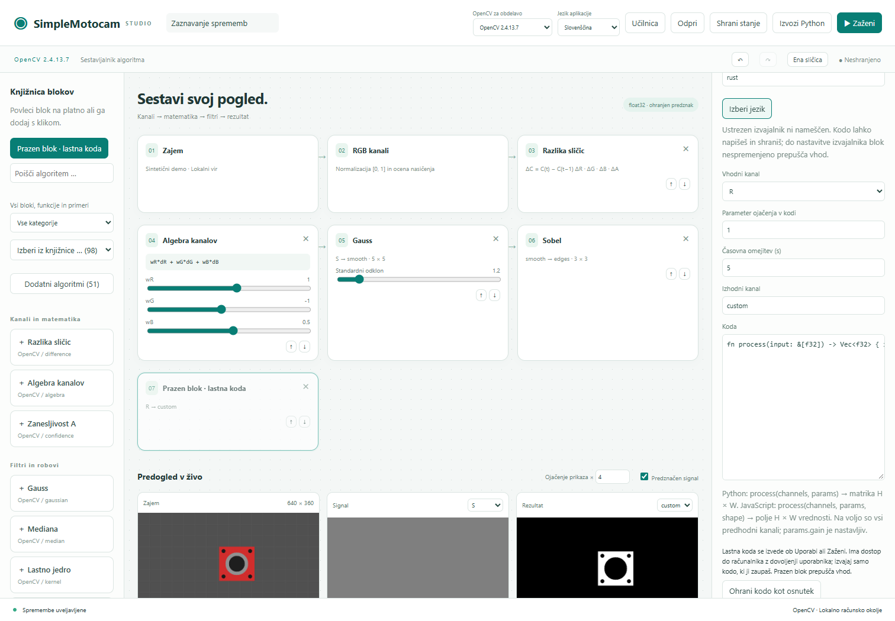
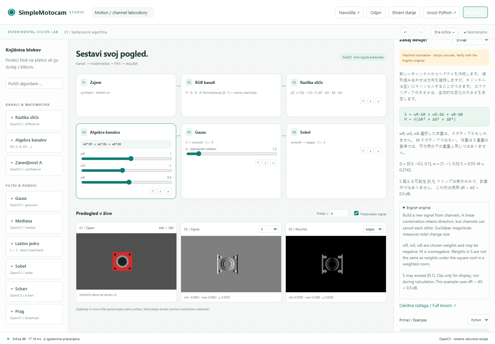
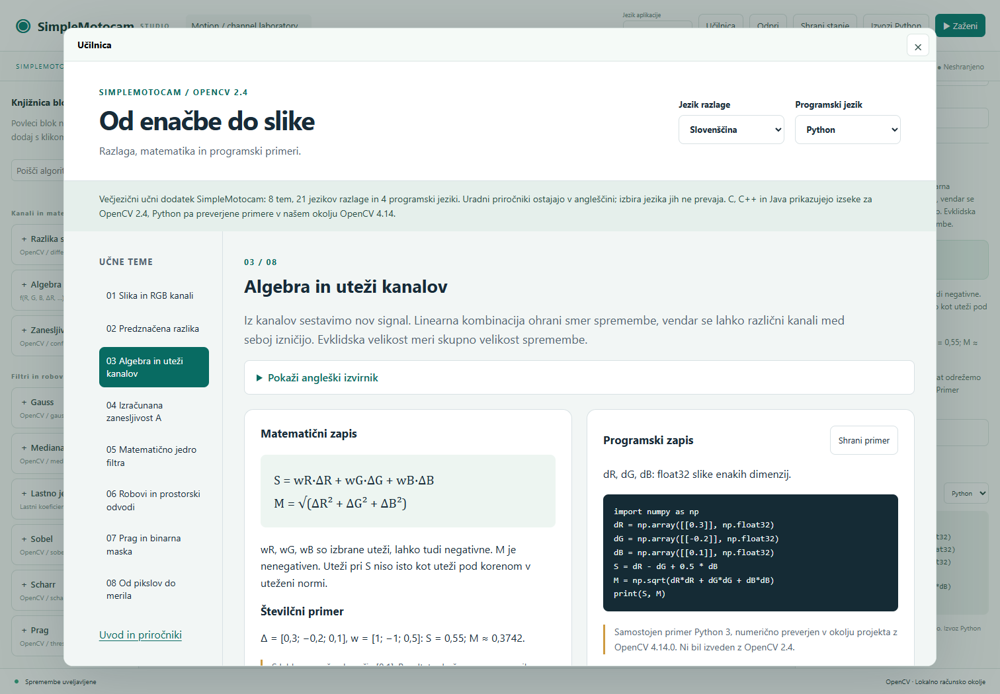
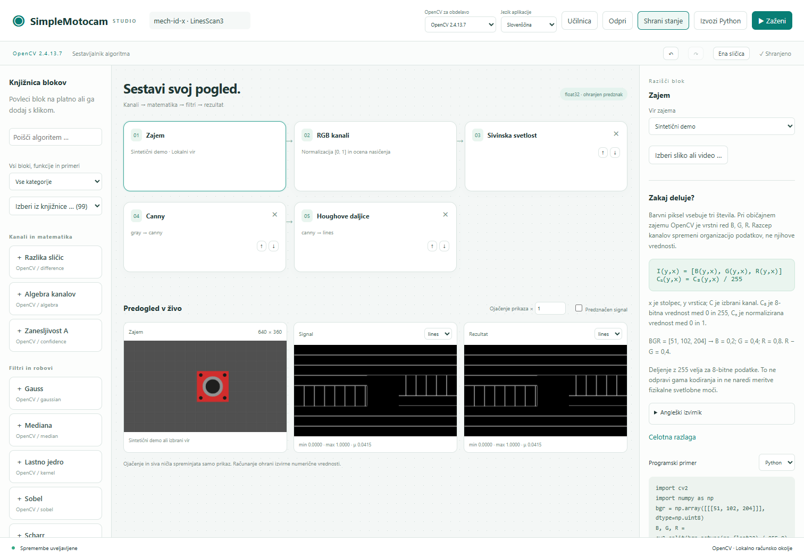
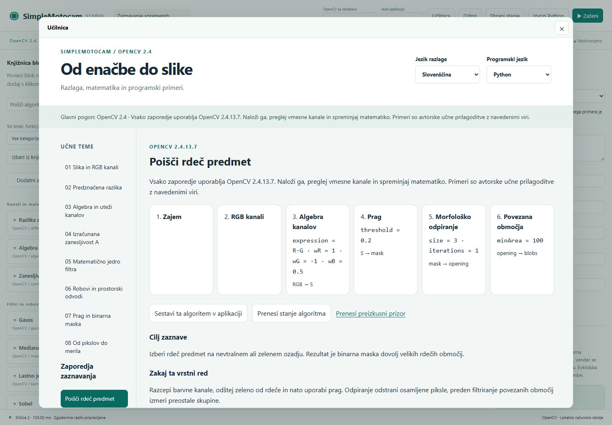

# SimpleMotocam · Simple OpenCV

**Build a vision algorithm. Inspect the mathematics. Save what works.**

[](https://github.com/dromation/Simple-OpenCV/actions/workflows/tests.yml)
[](LICENSE)
[](pyproject.toml)

A local visual laboratory for experimental computer vision, built on the original Simple-OpenCV repository. Arrange processing blocks, change equations and parameters, inspect live channel data, then export a standalone Python algorithm.



[Start here](#run-locally) · [Studio guide](docs/STUDIO.md) · [Learning companion](docs/opencv-2.4-manuals/learning/README.en.md) · [Contribute](CONTRIBUTING.md) · [Slovensko](#slovensko)

## From pixels to an experiment

| Build | Explore | Keep |
| --- | --- | --- |
| Drag blocks from a searchable library; reorder with drag or buttons | RGB float channels, exposure confidence, signed temporal differences | Versioned JSON configurations and portable downloads |
| Combine any earlier channels with editable mathematical expressions | Gaussian, median, editable 3×3 kernels, Sobel, Scharr and threshold | Standalone Python export with the same numerical engine |
| Choose demo, image, video or an explicit camera input | Live previews, raw min/max/mean and display-only gain | Undo/redo and saved-project loading |

```text
Source → RGB + A → Δ channels → Channel algebra → Gaussian → Sobel
                              S = wR·ΔR + wG·ΔG + wB·ΔB
```

The default moving part is synthetic. No camera is opened automatically. Images and computations stay on the local Python server; the frontend has no CDN or online translation requirement.

## Run locally

Requires Python 3.10+ and a modern browser. On Windows, double-click **Install-SimpleMotocam.cmd**, then **Start-SimpleMotocam.cmd**. The installer uses the project's isolated `.venv` environment.

Or install from source:

```sh
git clone --branch experimental/simplemotocam https://github.com/dromation/Simple-OpenCV.git
cd Simple-OpenCV
python -m venv .venv
# Windows: .venv\Scripts\activate
# macOS/Linux: source .venv/bin/activate
python -m pip install -e ".[dev]"
python -m simplemotocam.studio
```

The studio opens at **http://127.0.0.1:8765**. Use `--no-browser` or `--port 8766` if needed. Stop the local server with Ctrl+C. Any legacy `requirements.txt` in an existing checkout is an archival environment snapshot; use `pyproject.toml` for the new application.

## Your first saved algorithm

1. Press **Zaženi** to run the demo; select **Algebra kanalov** to edit the expression and weights.
2. Try `sqrt(dR**2 + dG**2 + dB**2)` for colour-change magnitude, or import [a colour-contrast preset](contrib/presets/color-contrast.json).
3. Add a filter or threshold and select its output in the preview. Use the explanation language and Python/C++/C/Java example selectors to inspect the underlying operation.
4. **Shrani stanje** saves a new local version and downloads JSON. **Odpri** restores it. Uploaded media stays in `.motocam/uploads` and must be selected again on another computer.
5. **Izvozi Python** downloads your complete runnable algorithm:

```sh
python simplemotocam_algorithm.py --frames 120 --show
python simplemotocam_algorithm.py --video sample.mp4 --show
python simplemotocam_algorithm.py --camera 0 --show
```

Export uses NumPy and OpenCV; graphs containing JavaScript blocks also require Node.js. The orchestrator is Python, with each block using its selected compatible runtime. C, C++ and Java remain available as learning examples; execution adapters for these languages are not yet installed.

## A library you can extend



- **28 block kinds:** channel mathematics, filters, morphology, Canny/Laplacian, automatic thresholds, component filtering, line detection and custom code.
- **Search + category filter + complete dropdown:** browse executable blocks, five math functions, your adapted examples, saved recipes, 37 original source references and the installed OpenCV API.
- **Your own code:** add an empty block directly, select or type any language, and keep separate language drafts in the saved project. Python and JavaScript execute with their built-in adapters; other languages can be connected through the [external adapter contract](docs/CUSTOM_CODE_ADAPTERS.md).
- **Compatible language choices:** Python handles native OpenCV operations; JavaScript executes custom code and four compatible built-ins through Node.js. Execution is enabled only when a compatible adapter is installed. Unavailable languages remain editable, saveable drafts that pass the input through.





Imported custom code waits for explicit execution. Workers enforce a time limit and output-shape/finite-value checks, but run with your user permissions and are not security sandboxes. Only run code you trust. See [code examples, numerical contracts and adapter extension instructions](docs/STUDIO.md#write-and-run-a-custom-block).

## Mathematics, in 21 explanation languages

The integrated learning companion covers channels, differences, algebra, confidence, filtering, gradients, thresholds and scale. It includes formulas, numerical examples and code in four programming languages.

Slovenščina · English · 日本語 · 中文 · Deutsch · Hrvatski · Српски · Русский · हिन्दी · Español · العربية · 한국어 · Italiano · Français · Polski · Svenska · Português · Bahasa Indonesia · ไทย · বাংলা · नेपाली





One language selector in the application header updates the studio controls, block library, parameters and lesson inspector together. The classroom opens as an overlay inside the studio; changing its language also updates the application. Close it with × or Escape to return to the same experiment. Block removal uses × in the top-right corner of each removable card.

English and Slovenian interface text and lessons are authored; **the other 19 languages are machine drafts**, visibly labelled and accompanied by the English original. Optional open-source [M2M100/CTranslate2 tooling](tools/doc_translate/README.md) generates the local catalogs. Equations and code remain protected. This is an eight-topic companion, not a translation of the entire OpenCV documentation.

Three unchanged [official OpenCV 2.4 PDF manuals](docs/opencv-2.4-manuals/README.md) are included for offline study. **OpenCV 2.4.13.7 is the primary engine**; optionally choose the **installed current OpenCV** in the application header. The 2.4 worker runs actual legacy core/imgproc operations, with all 28 registered block kinds available; [installation and compatibility](docs/OPENCV_BACKENDS.md) explain supported blocks and portable exports. The selected version is saved with the algorithm.

## Know what the numbers mean

- Most operations preserve signed float32 data. Canny and automatic thresholds explicitly quantize normalized input to 8-bit; display gain never changes the computation.
- `A` is an exposure-margin heuristic, not a measured transparency channel or probability.
- Temporal differences start at zero after an algorithm/source change. A single still image produces no ongoing temporal motion.
- Live previews are processed at a maximum side length of 960 pixels. Export processes the original size; match resolution when comparing spatial-filter results.
- The workspace is an ordered dataflow: inputs must exist earlier in the sequence. Invalid edits stop execution until repaired. The algebra expression parser remains restricted. Explicit custom-code blocks run trusted Python or JavaScript after Apply/Run, with local user permissions.
- Geometry and metrology directories are extension points. Calibrated physical measurements are **not implemented yet**.

See [the full numerical contract and operating guide](docs/STUDIO.md).

## Project map

```text
src/simplemotocam/     Numerical core, local server and browser studio
tests_core/           Mathematical, state, HTTP and standalone-export checks
contrib/presets/      Ready-to-import experiment configurations
docs/                Studio guide, screenshots, licenses and source manifests
tools/doc_translate/ Optional offline translation workflow
external/README.md   Pinned historical source references (large trees ignored)
smoto.py + screens/  Preserved original Kivy GUI
```

The original Kivy application, examples and Git history remain the base. New work is isolated in the experimental package; legacy scripts are not silently rewritten or run. The reference collections are [ComputerVision-MachineVision](https://github.com/mech-id-x/ComputerVision-MachineVision/tree/master/samples_code) and [SI_Eksperimenti_Strojnega_Vida](https://github.com/mech-id-x/SI_Eksperimenti_Strojnega_Vida).

Run `python -m pytest` for the numerical/API/export suite. Development and extension guidance: [CONTRIBUTING.md](CONTRIBUTING.md), [contrib/](contrib/README.md), [Code of Conduct](CODE_OF_CONDUCT.md).

## License

New application code and project-authored material use the **MIT license**, retaining Dromation's original copyright and adding mech-id-x/contributor attribution. Use, modification and commercial redistribution are permitted under its notice and warranty terms. External libraries, official manuals, translation models and historical examples retain their own terms; see [THIRD_PARTY_NOTICES.md](THIRD_PARTY_NOTICES.md).

## Slovensko

SimpleMotocam je lokalni laboratorij za sestavljanje algoritmov računalniškega vida. Zaženi namestitev, nato `Start-SimpleMotocam.cmd`. Bloke dodajaš iz leve knjižnice, spreminjaš enačbe in drsnike, spremljaš dejanske rezultate ter shraniš stanje ali izvoziš samostojno Python datoteko. [Navodila za studio](docs/STUDIO.md) opisujejo delovanje in omejitve; [slovenski učni vodič](docs/opencv-2.4-manuals/learning/README.sl.md) vključuje matematične razlage. Kamera se vključi šele ob izrecno izbranem zajemu. Meroslovje in geometrija ostajata naslednja razvojna modula.

### OpenCV 2.4 processing in the same studio



The header selects the processing version. This screenshot uses actual OpenCV 2.4 Canny and Hough operations; the graph, language selector and classroom remain in the same application.

### Learn by building a detector



The classroom adds six OpenCV 2.4 sequences: red-part segmentation, bright-region filtering, temporal changes, straight lines, noise-resistant edge detection, and local thresholding under uneven illumination. Each includes block order, equations, parameters, limits, and book/web sources. Load a complete graph and synthetic scene into the same studio. [Sources and details](docs/DETECTION_SEQUENCES.md).

The Windows installer now includes `Install-OpenCV24.cmd`. Native building requires Visual Studio C++ tools, the Windows SDK and CMake/Ninja; a missing legacy worker is reported explicitly. `python -m simplemotocam.studio --backend current` is an explicit alternative.

Your examples and saved algorithms are in **Additional algorithms / Dodatni algoritmi**, a separate collection opened on demand. The default sidebar shows the basic blocks; search and the complete dropdown remain available.
