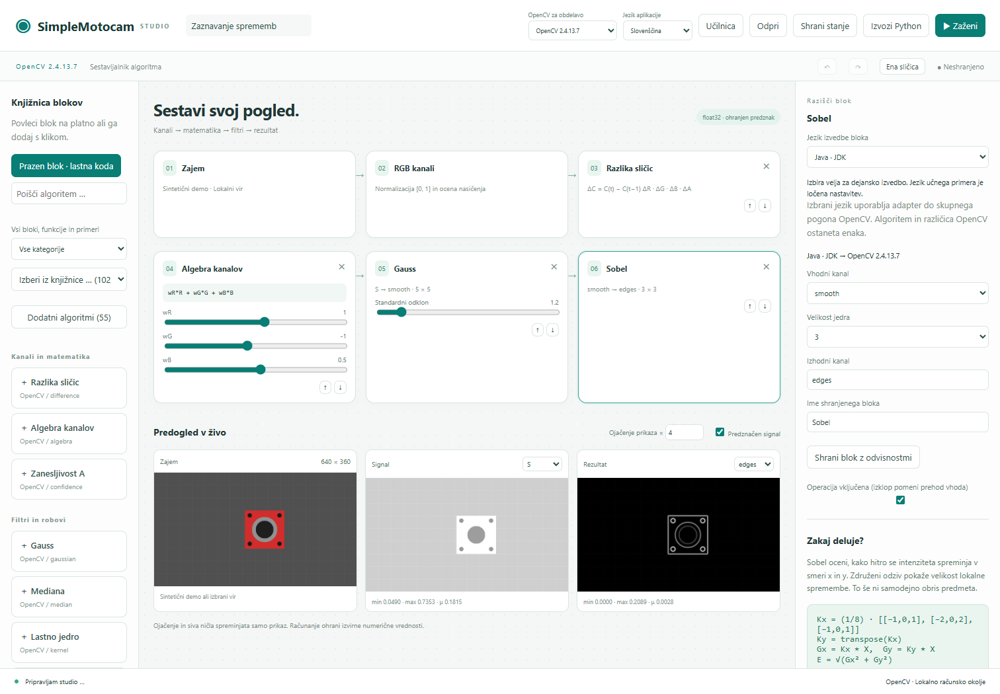

# Bloki C, C++ in Java

## Izbira jezika standardnega bloka

Izberi kartico in v nastavitvah **Jezik izvajanja** izberi C, C++ ali Java.
Izbira velja za posamezen blok, zato lahko sestaviš tudi mešano zaporedje:
**algebra C → Gauss C++ → Sobel Java**. Na voljo je 25 vrst blokov, vključno
z lastno kodo; zajem, razcep kanalov in časovna razlika ostanejo skupne stopnje.



| Vrsta bloka | Kaj se dejansko izvede |
| --- | --- |
| Algebra, zaupanje, luminanca, barvna razdalja, inverzija | Iz enačbe nastane koda C/C++/Java, ki se prevede in izračuna kanal. |
| 19 filtrov in zaznav OpenCV | Preveden adapter izbranega jezika zažene skupni pogon OpenCV z istimi podatki in parametri. |
| Prazen blok / lastna koda | Prevede in izvede tvojo funkcijo `process`. |

Prevajalnik pripravi program, adapter prenese podatke, pogon OpenCV pa izvede
operacije računalniškega vida. Glavni profil uporablja pravi C++ pogon
**OpenCV 2.4.13.7**. Izbirni trenutni profil uporablja nameščeni `cv2` prek
storitve Python. Izbira jezika ne spremeni različice OpenCV in ne pomeni
neposrednih vezav C ali Java za celoten API OpenCV. Vmesnik prikazuje način
izvajanja in uporabljeno različico.

Prevedeni programi se ponovno uporabljajo; spreminjanje številskih parametrov
matematičnega bloka ne zahteva novega prevajanja. Sprememba enačbe ga zahteva.
Pogonski adapter se prevede enkrat na jezik in konfiguracijo prevajalnika.
Vsaka sličica še vedno potrebuje procese in prenose podatkov, zato mešano
izvajanje ni zagotovilo obdelave v realnem času. Pogonski klic ima omejitev
10 sekund; prevajanje 30 sekund. Napake in prekoračitve ustavijo izračun.

Shranjeno stanje ohrani jezike, enačbe, parametre in profil OpenCV. Izvoz je
samostojen program Python, ki vsebuje iste adapterje in orkestrira izbrane
jezike. Na ciljnem računalniku potrebuje ustrezne prevajalnike in pogon OpenCV.
Preverjanja primerjajo vseh 19 filtrov z neposrednim klicem istega pogona,
matematične izračune z referenco ter mešana zaporedja z njihovim izvozom.

## Lastna funkcija

1. Dodaj **Prazen blok · lastna koda** ali odpri **Napiši / uredi kodo** na kartici.
2. Izberi **C**, **C++** ali **Java** in klikni **Vstavi začetno funkcijo**.
3. Spremeni funkcijo in izberi **Uporabi in izvedi kodo**. Napake prevajalnika
   ali programa se prikažejo pod urejevalnikom.
4. Izhodni kanal uporabi v naslednjem bloku: na primer lastna razlika R−G →
   Gauss → prag → filtriranje območij. Operacije OpenCV uporabijo izbrani pogon,
   vključno z glavnim OpenCV 2.4.13.7.

Vsi trije izvajalniki so vključeni v aplikacijo. Potrebujejo lokalni prevajalnik:

| Jezik | Podprta orodja | Pogodba |
| --- | --- | --- |
| C | MSVC s podporo C11 ali GCC/Clang | `void process(const SmContext *ctx, float *out)` |
| C++ | MSVC, G++ ali Clang++ s podporo C++17 | `void process(const SmContext& ctx, float *out)` |
| Java | JDK z ukazoma `javac` in `java`; preverjeno z JDK 11 | metoda `public static float[] process(Map<String,float[]> channels, Params p)` |

Windows samodejno poišče Visual Studio C++ Build Tools prek `vswhere` in uporabi
okolje za x64 brez globalnega spreminjanja PATH. GCC/Clang ter JDK morajo biti
na PATH. Prevladni prevajalnik C/C++ lahko določiš z `SIMPLEMOTOCAM_CC` oziroma
`SIMPLEMOTOCAM_CXX` (pot do programa, brez argumentov). Po namestitvi orodij
ponovno zaženi strežnik. Brez orodij je kodo še vedno mogoče pisati in shraniti
kot izključen osnutek; aplikacija je ne izvede v drugem jeziku.

## C: predznačena barvna razlika

```c
void process(const SmContext *ctx, float *out) {
    const float *r = sm_channel(ctx, "R");
    const float *g = sm_channel(ctx, "G");
    for (int i = 0; i < ctx->rows * ctx->cols; ++i) {
        out[i] = (r[i] - g[i]) * (float)ctx->gain;
    }
}
```

## C++: enak izračun z referenco na kontekst

```cpp
void process(const SmContext& ctx, float *out) {
    const float *r = sm_channel(&ctx, "R");
    const float *g = sm_channel(&ctx, "G");
    for (int i = 0; i < ctx.rows * ctx.cols; ++i) {
        out[i] = (r[i] - g[i]) * static_cast<float>(ctx.gain);
    }
}
```

V C/C++ aplikacija pripravi `SmContext`, pomožno funkcijo `sm_channel`, vhod in
izhod ter `main`. Pišeš funkcijo `process` in poljubne pomožne funkcije, ne
lastnega `main`. `ctx.input` (v C `ctx->input`) je ime kanala iz izbirnika.
`rows`, `cols`, `gain` in `backend` so podatki trenutne sličice. Pri manjkajočem
kanalu `sm_channel` izpiše napako. C++ podpira tudi standardne knjižnice;
vključeni so `<vector>`, `<algorithm>` in `<stdexcept>`.

## Java: metoda v pripravljenem razredu

```java
public static float[] process(Map<String, float[]> channels, Params p) {
    float[] r = channels.get("R");
    float[] g = channels.get("G");
    float[] out = new float[p.rows * p.cols];
    for (int i = 0; i < out.length; ++i) {
        out[i] = (r[i] - g[i]) * (float)p.gain;
    }
    return out;
}
```

Metode se vstavijo v generirani razred `UserBlock`; ne ovijaj jih še v lasten
razred `UserBlock` in ne dodajaj `package` ali `import` vrstic. Na voljo so
`java.util.*`, `java.nio.*` in `java.nio.file.*`; druge razrede lahko nasloviš s
polnim imenom. `p.input`, `p.rows`, `p.cols`, `p.gain`, `p.backend` imajo enak
pomen kot kontekst C/C++. Java uporablja največ 256 MB pomnilnika za kopico.

## Podatki, prevajanje in izvoz

- Kanali so sploščeni float32 po vrsticah: indeks `y * cols + x`. Na voljo so
  RGB, izpeljani A in vsi predhodni kanali. Predznačene vrednosti ostanejo
  predznačene. `gain` je parameter kode, ne ojačanje prikaza.
- Zapiši oziroma vrni natanko H × W končnih vrednosti. C/C++ izhod se pred
  izvajanjem napolni z NaN, zato neizpisani elementi povzročijo vidno napako.
- Prvi izrecni zagon prevede kodo, z omejitvijo 30 sekund. Naslednje sličice
  uporabljajo preveden program. Sprememba vhodnih podatkov, dimenzij ali `gain`
  ne sproži nove gradnje. Sprememba kode ali poti do prevajalnika jo sproži.
  Strežnik hrani največ 32 uspešnih gradenj v začasnem predpomnilniku.
- Časovna omejitev bloka velja za izvajanje prevedenega programa. Vsaka sličica
  dobi svež proces; statične spremenljivke ne hranijo zgodovine med sličicami.
  Napake ne premaknejo zgodovine sličic.
- Shranjeni projekt hrani izvorno kodo in jezik. Izvoz Python vsebuje tudi
  adapterje in kodo; na drugem računalniku potrebuje iste odvisnosti ter ustrezen
  prevajalnik/JDK. Prevedenih programov ne vključi v projekt.

Ti adapterji izvajajo lastne operacije nad kanali. Ne dodajajo neposredne
povezave z vsemi knjižnicami C/C++/Java OpenCV ali samodejnega uvoza učbeniških
programov z `main`. Za operacije OpenCV uporabi naslednje oziroma predhodne
bloke izbranega pogona. Izvajanje lastne kode ima pravice lokalnega uporabnika;
ni varnostni peskovnik. Običajna standardna izhodna sporočila se ne prikazujejo;
ob neuspelem procesu se prikaže diagnostični izhod stderr.
